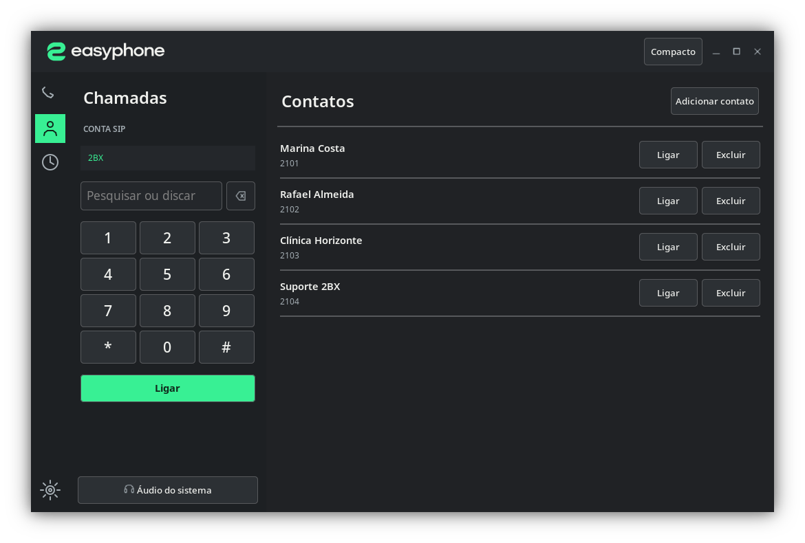
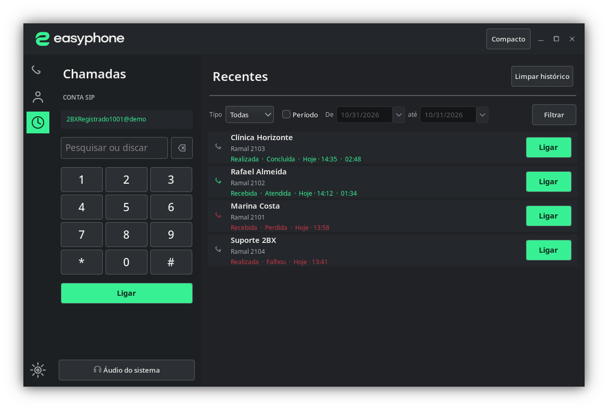
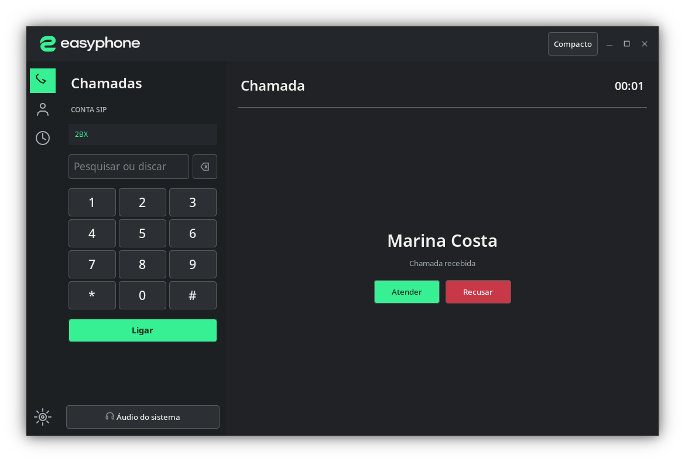
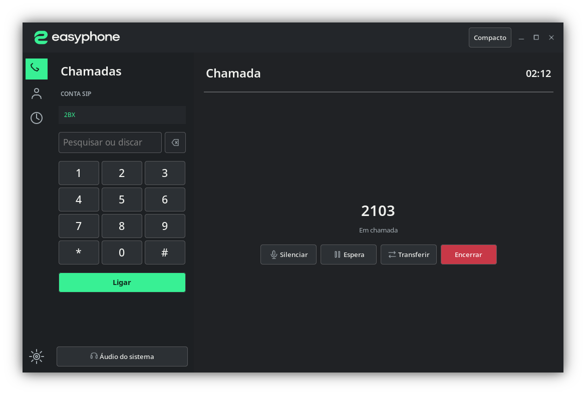
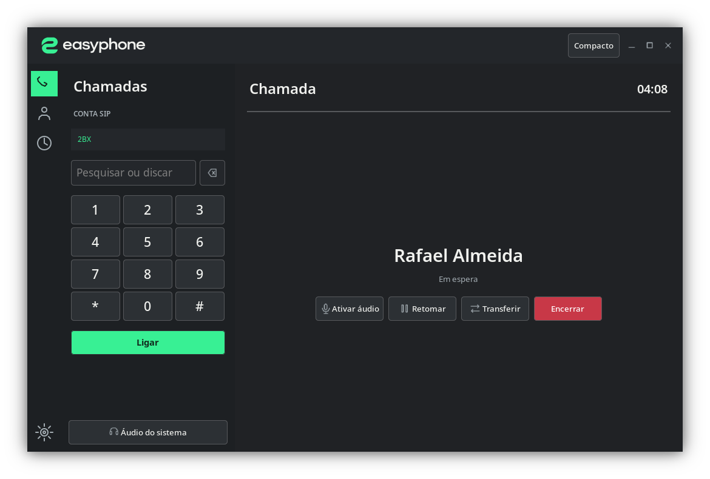
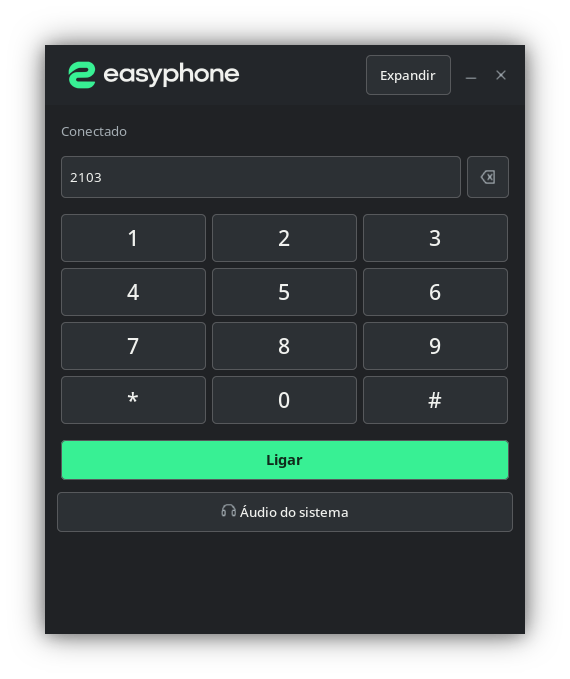
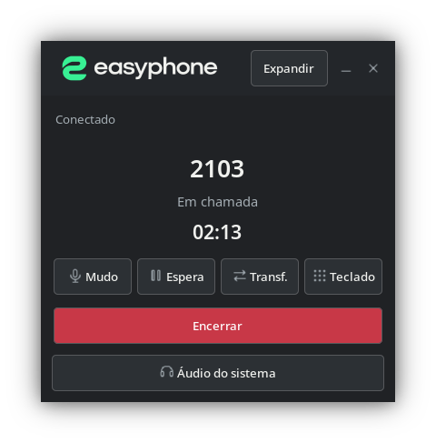
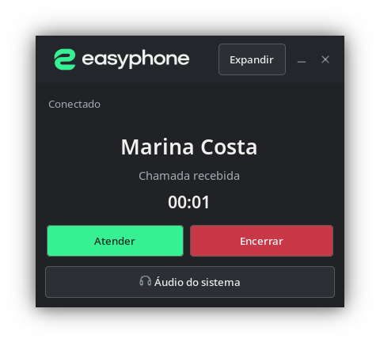
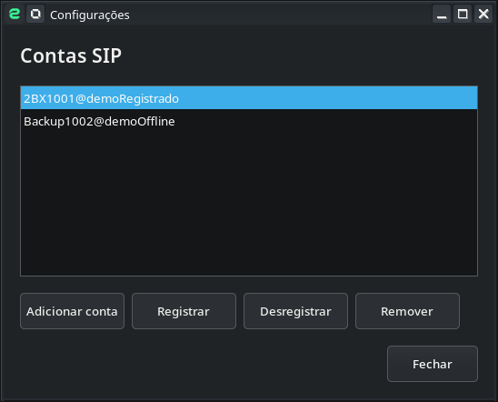
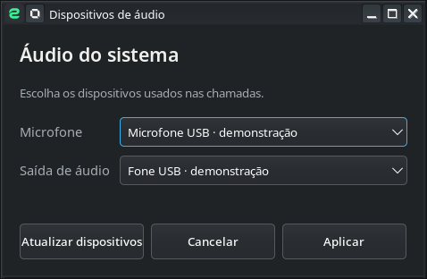

# easyphone

O easyphone é um softphone SIP para desktop, desenvolvido pela equipe 2BX. Reunimos discagem, chamadas, contatos, histórico e controles de áudio em uma interface nativa, com suporte a contas SIP convencionais.

## Interfaces do produto

Capturas da interface nativa em execução no Linux. Todos os nomes, ramais, contas e dispositivos abaixo são dados fictícios de demonstração.

| Discador | Contatos |
|---|---|
|  |  |

| Recentes | Chamada recebida |
|---|---|
|  |  |

| Chamada ativa | Chamada em espera |
|---|---|
|  |  |

| Discador compacto | Chamada ativa compacta |
|---|---|
|  |  |

| Chamada recebida compacta | Contas SIP |
|---|---|
|  |  |

| Dispositivos de áudio |
|---|
|  |

## Download

Baixe a versão mais recente na página de [Releases](https://github.com/adriano2bx/easyphone/releases). A versão atual oferece pacotes para **Linux x86_64**.

### Debian e derivados

```sh
sudo apt install ./easyphone_0.4.1_amd64.deb
```

### Instalação portátil

```sh
tar -xzf easyphone-linux-x86_64-v0.4.1.tar.gz
./easyphone/INSTALL-LOCAL.sh
```

A instalação portátil não exige privilégios de administrador. Ela cria a entrada do easyphone no menu de aplicativos e um atalho na área de trabalho.

## Uso no desktop

Adicione sua conta SIP em **Configurações**. O easyphone mantém a conta registrada quando a janela é minimizada ou fechada e fica disponível pela bandeja do sistema. No menu da bandeja, é possível reabrir a janela ou sair do aplicativo.

Para fixar o easyphone no painel do KDE, abra o aplicativo, clique com o botão direito no ícone do Gerenciador de Tarefas e escolha **Fixar no Gerenciador de Tarefas**. O KDE controla essa ação por usuário, então o instalador não altera o painel automaticamente.

Para remover a instalação portátil, execute `~/.local/opt/easyphone/UNINSTALL-LOCAL.sh`. As contas e preferências são preservadas. Remova a versão Debian com `sudo apt remove easyphone`.

## O projeto

A interface usa wxWidgets. Electron integra o ciclo de vida do aplicativo e o armazenamento seguro de contas. Baresip cuida da sinalização SIP convencional e do áudio. As senhas ficam protegidas pelo mecanismo seguro do sistema operacional.

O repositório inclui o código da interface, a integração com o motor SIP, os recursos visuais da marca e os scripts de empacotamento. Os instaladores incluem os avisos de licença dos componentes distribuídos.

## Plataformas

| Sistema | Disponibilidade |
|---|---|
| Linux x86_64 | Pacotes `.deb` e portátil disponíveis em Releases |
| Windows | Build e instalador em desenvolvimento |
| macOS | Build e instalador em desenvolvimento |

O código da interface é compartilhado entre plataformas, mas cada sistema exige build e validação próprios, especialmente para áudio, bandeja e armazenamento de credenciais.

## Desenvolvimento

Para compilar a interface no Linux, instale CMake, um compilador C++17, wxWidgets 3.2 e `nlohmann-json`:

```sh
cmake -S native-wx -B native-wx/build -DCMAKE_BUILD_TYPE=Release
cmake --build native-wx/build
```

O empacotamento completo também requer um runtime Electron Linux x86_64 e o prefixo isolado do Baresip. Consulte [`packaging/README-LINUX.md`](packaging/README-LINUX.md) para preparar esses componentes e gerar os pacotes.

## Identidade visual

O kit de marca está em [`branding/easyphone/`](branding/easyphone/), com logotipos, ícones por tamanho, tokens de design e guia de identidade.

---

Desenvolvido pela equipe 2BX.
